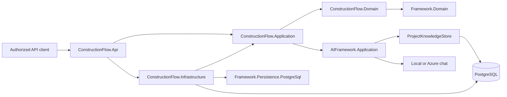

# Architecture

ConstructionFlow owns construction entities, workflow rules, membership resolution, data, migrations, provider selection and HTTP endpoints. Framework remains a general foundation; AI-Framework remains an independent capability library. Neither shared repository depends on ConstructionFlow.

The Application layer owns access checks and explicit `ProjectWorkflow`, `ProcurementWorkflow`, `SiteReportWorkflow` and `KnowledgeWorkflow` services. Infrastructure implements the application-owned `IConstructionStore` port; write endpoints delegate to workflows and preserve HTTP shapes. Simple bounded read queries remain in the API. Infrastructure derives `ConstructionDbContext` from the provider-neutral Framework.Persistence context and selects only the PostgreSQL adapter. The runtime does not depend on AutoMapper, SQL Server or the legacy Framework.Infrastructure facade. Generic CRUD controllers/repositories are not used for approval workflows because they do not establish tenant/resource permissions.

## Authorization and transactions

JWT signatures, issuer, audience and expiry are validated. The token's `sub` resolves an active local user; `tenant_id` selects an active tenant and requires an active membership. Roles come from database rows, not arbitrary token claims or request bodies. The current deployment trusts one configured issuer; multiple issuers require an `(issuer, subject)` identity key migration.

Owners/admins administer their tenant. Other roles need project membership; project role controls the operation. Tenant-wide procurement can manage suppliers but still needs a project role for RFQs. Unassigned projects and documents return 404, and counts use the same scoped project query. Project managers/owners ingest reviewed evidence; permitted project readers can ask questions. Subcontractors have no access in this milestone because restricted assignment and document permissions are not yet modeled.

EF query filters enforce tenant scope and the save guard rejects empty/foreign tenant contexts. Composite foreign keys enforce tenant/project/RFQ/document/member relationships. These complement endpoint project authorization; query filters alone do not authorize a user. Database administrators can bypass application guards: production roles, append-only database permissions/triggers, RLS and privileged maintenance procedures remain hardening work.

Domain methods validate state and expected version. EF checks `row_version` in update predicates and increments it on writes. Financial arithmetic uses decimal with explicit rounding. Audit rows contain actor, action and aggregate identifiers, with no document bodies/questions; they commit with business writes through the same `SaveChanges` transaction. This is audit persistence, not an outbox or a delivery queue.

## AI composition

`ConstructionProfiles` supplies the product's human-review profile. `DocumentIngestionService` validates and chunks reviewed text; `ProjectKnowledgeStore` atomically saves immutable document metadata/chunks. `KnowledgeAnswerService` retrieves evidence with tenant, project and optional document filters and performs its shared second scope check before generation. The host authorizes the project first and rejects unknown/out-of-project document selections.

The PostgreSQL retriever filters matching terms in SQL, reads at most 200 candidates and ranks matches deterministically. This baseline is durable and intentionally limited: no semantic/vector retrieval, no page extraction, no relevance calibration, no conflict detector and no contractual certainty. It abstains when no matching evidence is found. Retrieved evidence does not prove every generated assertion. The UI must display review notices and citations; AI text is never an approval.

Local uses the shared deterministic extractive model in Development. Azure uses the shared chat adapter with PostgreSQL retrieval; the registered embedding model is reserved for future hybrid search. Binary uploads, storage signing, malware scanning, OCR, structured extraction, speech, job queues, retries, outbox delivery and spend quotas are not implemented. There is deliberately no idle worker claiming to process documents.

## Operational boundaries

The host has JSON logs, ProblemDetails trace IDs, a 512 KiB request-body limit and 10 AI requests/minute per authenticated tenant/subject. Body validation further caps reviewed text at 100,000 characters. These are initial bounds, not subscription quotas or complete observability. Database connection readiness is distinct from process liveness. Production needs schema readiness gates, telemetry, service budgets, backup/restore drills and deployment-specific identity/security validation.
